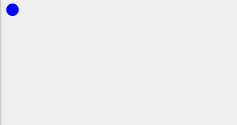
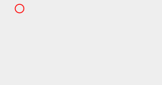

# Manual (Age of Farmers)

### 1. Startup

When starting the game, an input dialog will appear. This dialog will ask for the number of players that will play the current game. This number should be between 1 and 5 (inclusive). Every game will also include 1 AI (dubbed _Thor_).

For every human player, another set of dialogs will be shown, asking for the (ingame) name of the player and the player colour.

Depending on the name entered by the player, one of two things might happen:

* The name has been used before and a player profile exists in the folder <code>SavedGames/</code>. The existing profile will be loaded.
* No existing profile can be recovered. In this case, a new (empty) one will be generated.

Currently, there is no way to override an existing profile (aside from moving it outside the designated folder.)

### 2. Object selection

* In the main **game screen**, cells where objects of the current player reside will be indicated by a small (filled) circle of the player's colour.
  <figure style = "text-align: center; margin: 15px" id = "player_cell">
    
    <figcaption>Fig. 1: Player cell</figcaption>
  </figure>
  Cells where objects of an enemy player reside will be indicated by a small circle of the enemy's colour.
  <figure style = "text-align: center; margin: 15px">
    
    <figcaption>Fig. 2: Enemy cell</figcaption>
  </figure>

* A cell can be selected by clicking it (only cells that contain the player's objects can be selected, as in <a href = "#player_cell">Fig. 1</a>).
* In the **cell panel**, objects are shown in three places:
  * Top row: Owned units.
  * Middle row: Enemy/allied objects. The owner of each object is indicated by a coloured box.
  * Bottom row: Owned buildings (and foundations).

    Depending on the type of the selected object, the middle row will look differently. If the selected object has a 'range' attribute, objects from neighbouring cells will also be shown.

* Clicking on an object in the cell panel will open up to two additional panels:
  1. An **info panel** showing all the relevant information about the selected object, e.g. type, name, health, ...
  2. An **action panel** showing the different actions this object can perform, e.g. work, construct, attack, ...

### 3. Modding

Modding is based on the <code>Jackson</code> library. |TODO|